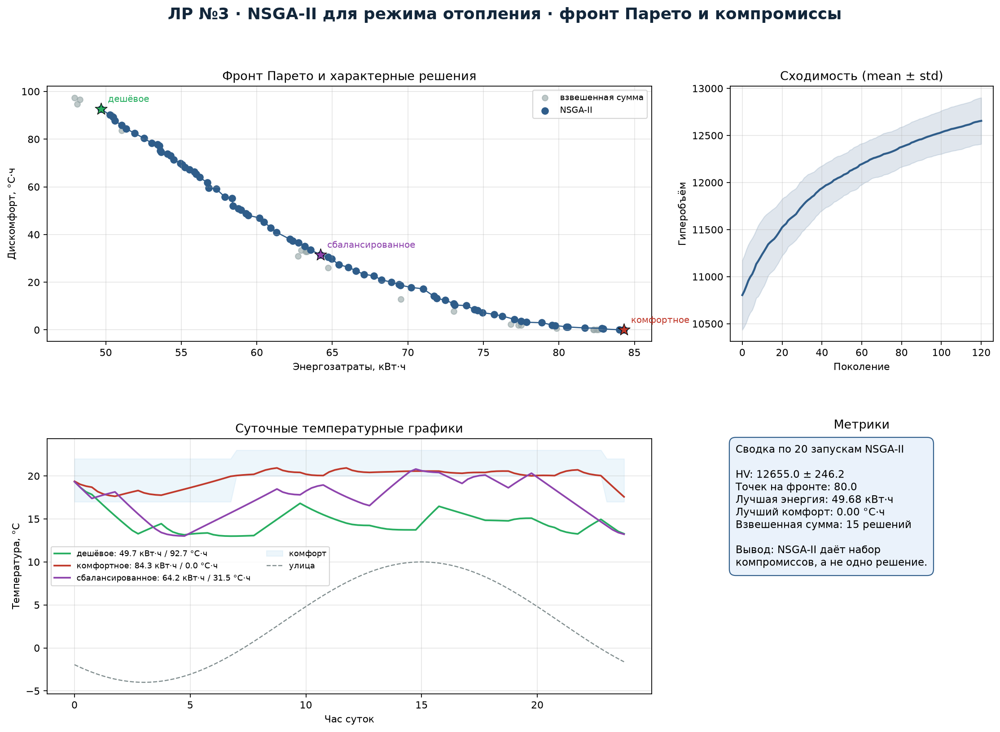
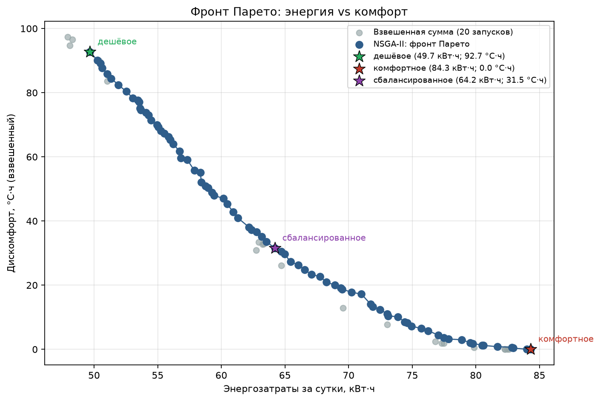
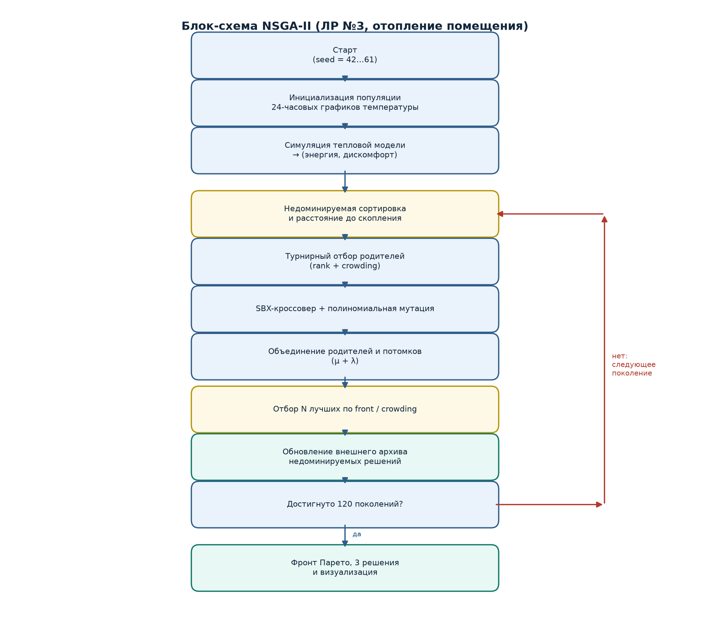
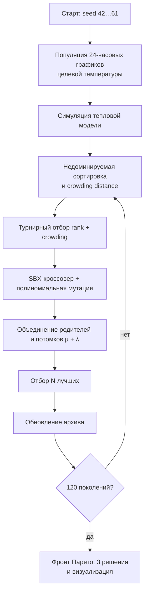
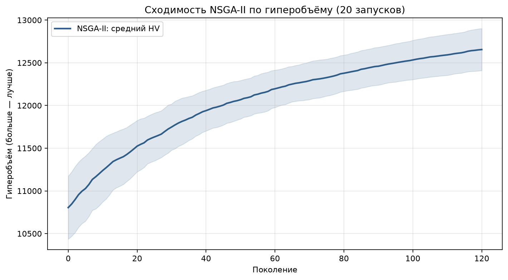
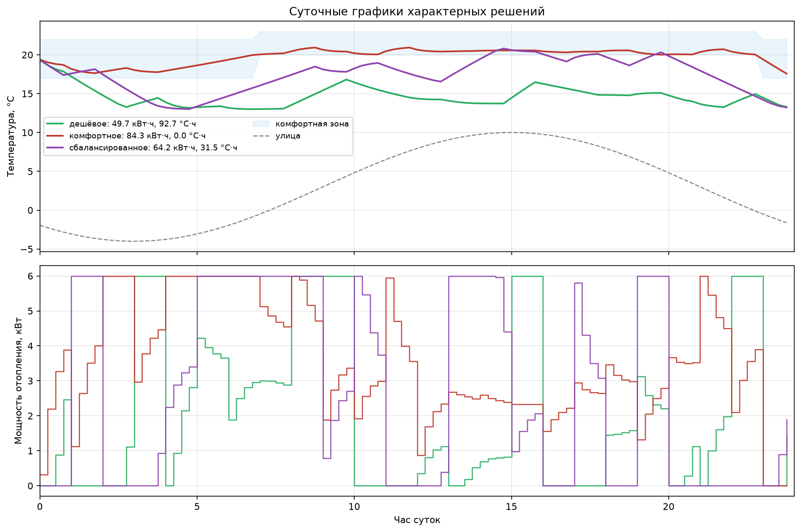

# Лабораторная работа №3
## Многокритериальная оптимизация режима отопления (NSGA-II)


**Студент:** Якимов Максим Андреевич  
**Группа:** Б24-517, № в группе 30  
**Вариант:** 4, трек A  
**Дисциплина:** «Эволюционное программирование и генетические алгоритмы»

---

## Дашборд



## Фронт Парето



Критерии: энергозатраты за сутки (кВт·ч) и интегральное отклонение
температуры от комфортной зоны (°C·ч). Оба критерия минимизируются.

| Решение | Энергия, кВт·ч | Дискомфорт, °C·ч |
|---|---:|---:|
| «Дешёвое» | 49.68 | 92.71 |
| «Сбалансированное» | 64.20 | 31.52 |
| «Комфортное» | 84.31 | 0.00 |

## Блок-схема NSGA-II





## Модель

- Горизонт 24 ч, шаг 0.25 ч, 96 шагов.
- Тепловая модель: $T_{t+1}=T_t+\frac{\Delta t}{C}(UA(T^{out}_t-T_t)+P_t)$,
  $C=1.8$ кВт·ч/К, $UA=0.22$ кВт/К, $P_{\max}=6$ кВт.
- Геном: 24 целевые температуры в диапазоне 14–24 °C.
- Комфорт: днём 20–23 °C, ночью 17–22 °C.
- NSGA-II: популяция 80, 120 поколений, SBX ($\eta=15$), полиномиальная
  мутация ($\eta=20$), элитизм $(\mu+\lambda)$.

## Результаты

- Средний гиперобъём за 20 запусков: **12655 ± 246**.
- Среднее число точек фронта: **80**.
- Минимальная энергия: **49.68 кВт·ч**.
- Минимальный дискомфорт: **0 °C·ч**.
- Взвешенная сумма даёт лишь **15** недоминируемых точек и уступает NSGA-II
  по покрытию фронта.





## Быстрый запуск

```bash
pip install -r requirements.txt
python main.py
```

Результаты в `lab3_out/`:

- `lab3_pareto.csv` — фронт Парето;
- `lab3_representatives.csv` — три характерных решения;
- `lab3_runs.csv` — метрики 20 запусков;
- `lab3_weighted.csv` — сравнение с взвешенной суммой;
- `lab3_dashboard.png`, `lab3_pareto.png`, `lab3_block_schema.png`.

## Отчёт

Готовый PDF: [`report.pdf`](report.pdf). Исходник: [`report.md`](report.md).
