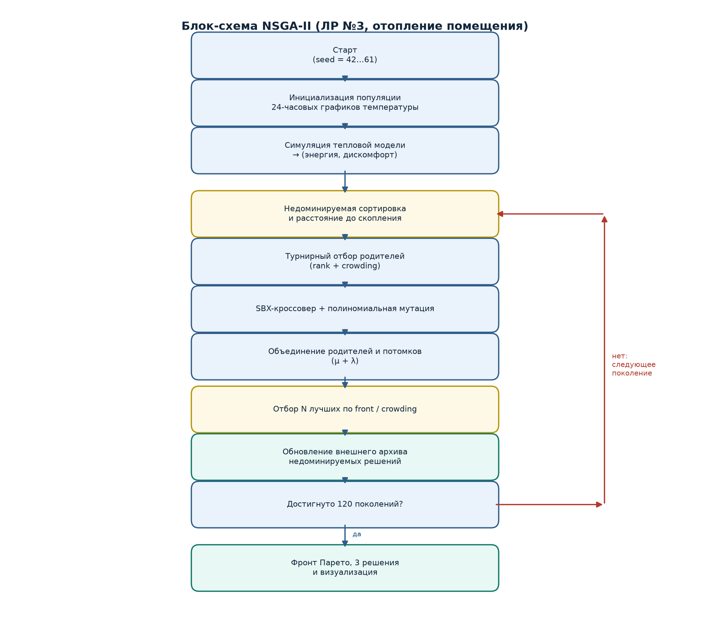
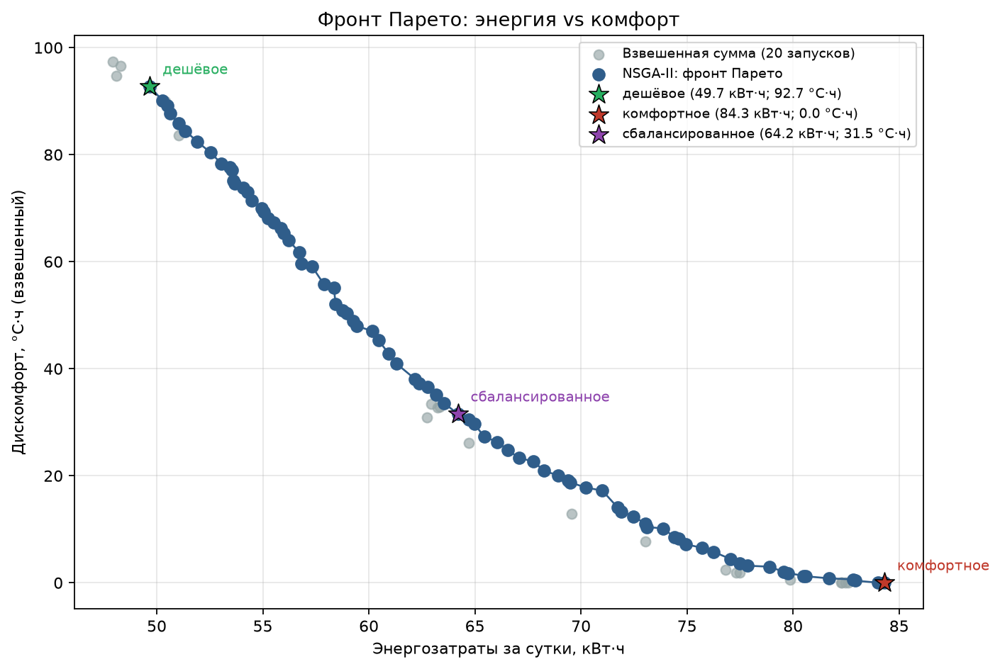
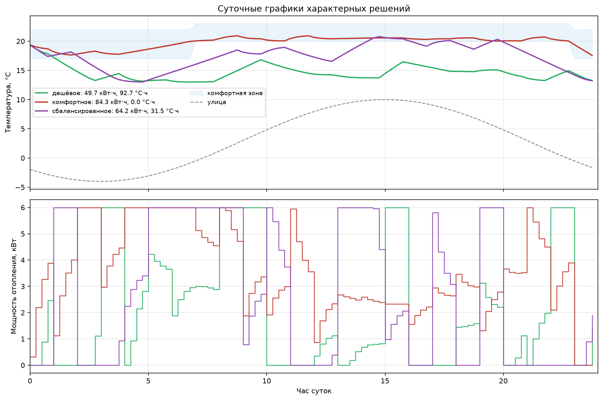
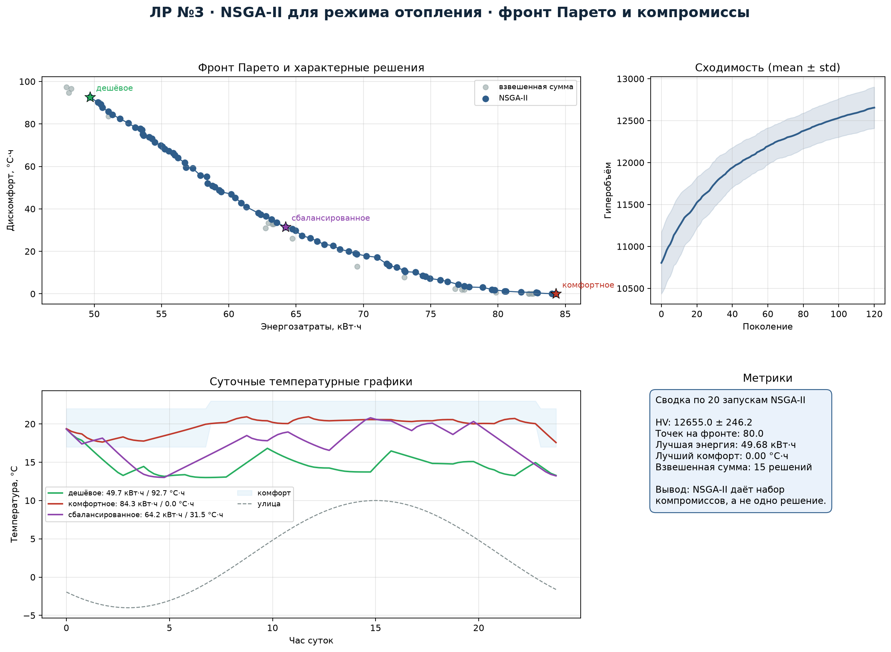

# 1. Постановка задачи и вариант

**Вариант:** 4, трек A — многокритериальная эволюционная оптимизация.

**Прикладная задача:** настройка суточного режима отопления помещения.
Требуется выбрать график целевой температуры по часам, минимизируя
одновременно два противоречивых критерия:

- $f_1$ — энергозатраты за сутки, кВт·ч (минимизировать);
- $f_2$ — интегральное отклонение температуры от комфортной зоны, °C·ч
  (минимизировать).

Конфликт очевиден: снижение целевой температуры экономит энергию, но
увеличивает дискомфорт; поддержание комфорта требует дополнительного нагрева.

# 2. Формальная модель

- Горизонт: 24 ч, шаг $\Delta t=0.25$ ч (96 шагов).
- Состояние: температура помещения $T_t$, °C.
- Управление: целевая температура на каждый час $u_h\in[14,24]$, $h=0,\ldots,23$.
- Тепловая модель:
  $$T_{t+1}=T_t+\frac{\Delta t}{C}\left(U\!A\,(T^{\text{out}}_t-T_t)+P_t\right),$$
  где $C=1.8$ кВт·ч/К — теплоёмкость, $U\!A=0.22$ кВт/К — теплопотери,
  $T^{\text{out}}_t$ — уличная температура, $P_t=\min(P_{\max},\max(0,K_p(u_h-T_t)))$ —
  мощность отопления, $P_{\max}=6$ кВт, $K_p=3$ кВт/К.
- Комфортная зона: днём (07:00–23:00) 20–23 °C, ночью 17–22 °C.
- Критерии:
  $$f_1=\sum_t P_t\Delta t,\qquad
  f_2=\sum_t w_t\left(\max(0,T^{\text{low}}_t-T_t)+\max(0,T_t-T^{\text{high}}_t)\right)\Delta t,$$
  где $w_t=1$ днём и $0.35$ ночью.
- Дополнительно введён мягкий штраф за технологические нарушения
  ($T<8$ °C или $T>30$ °C).

# 3. Представление особи

Генотип — вещественный вектор из 24 целевых температур (по одной на час).
Фенотип совпадает с генотипом: график подаётся в симулятор тепловой модели.
Ограничения $[14,24]$ обрабатываются clip после кроссовера и мутации.

# 4. NSGA-II

Реализованы с нуля:

- недоминируемая сортировка (fast non-dominated sort);
- расстояние до скопления (crowding distance);
- бинарный турнир по рангу и crowding distance;
- SBX-кроссовер ($\eta=15$, $p_c=0.9$);
- полиномиальная мутация ($\eta=20$, $p_m=1/24$);
- элитизм $(\mu+\lambda)$: родители и потомки объединяются, затем выбираются
  лучшие по фронтам и crowding distance;
- внешний архив недоминируемых решений и гиперобъём как метрика сходимости.

Параметры: популяция 80, 120 поколений, 20 независимых запусков (seed 42…61).

# 5. Блок-схема

# 6. Результаты

За 20 запусков средний гиперобъём составил **12655 ± 246**, на фронте в
среднем **80 недоминируемых точек**. Лучший запуск дал фронт, показанный ниже.

| Характерное решение | Энергия, кВт·ч | Дискомфорт, °C·ч |
|---|---:|---:|
| «Дешёвое» (минимум энергии) | 49.68 | 92.71 |
| «Сбалансированное» (колено) | 64.20 | 31.52 |
| «Комфортное» (минимум дискомфорта) | 84.31 | 0.00 |

# 7. Сравнение с взвешенной суммой

Для сравнения выполнено 20 запусков однокритериального ГА со случайными
весами $w$: минимизировалась свёртка $w f_1/60+(1-w)f_2/100$. Взвешенная
сумма даёт лишь 15 недоминируемых точек и не покрывает вогнутые участки
фронта; NSGA-II строит существенно более плотное и широкое множество
компромиссов. Это ожидаемо: взвешенная сумма находит только решения,
оптимальные для некоторого линейного скалярного критерия, и не может
воспроизвести все точки фронта Парето.

# 8. Содержательная интерпретация

- «Дешёвое» решение соответствует ночному снижению температуры и экономии
  энергии; комфорт нарушается в утренние и вечерние часы.
- «Комфортное» решение поддерживает температуру в зоне 20–23 °C всё время,
  но требует примерно на 70 % больше энергии.
- «Сбалансированное» решение экономит около 24 % энергии относительно
  комфортного, сохраняя дискомфорт на уровне 31.5 °C·ч.

Практический выбор зависит от тарифа на энергию и требований жильцов:
при высоком тарифе разумно «дешёвое» решение с ночным снижением температуры,
при приоритете комфорта — «комфортное».

# 9. Выводы

1. NSGA-II без готовых библиотек корректно строит фронт Парето для
   двумерной задачи с непрерывным управлением.
2. Недоминируемая сортировка и crowding distance обеспечивают одновременно
   сходимость к фронту и разнообразие решений.
3. Задача отопления имеет выраженный компромисс: диапазон энергии
   49.7–84.3 кВт·ч соответствует диапазону дискомфорта 92.7–0 °C·ч.
4. Взвешенная сумма уступает NSGA-II по числу и покрытию компромиссов,
   поэтому для поддержки принятия решений выбран многокритериальный подход.
